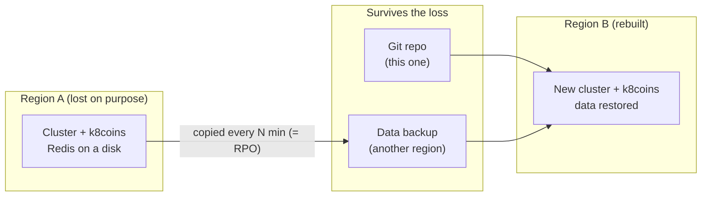

# k8s-region-recovery

[](https://github.com/0Aleksander/k8s-region-recovery/actions/workflows/pr-check.yml)
[](LICENSE)


**How long does it take to get a Kubernetes app back, with its data, after you lose the whole region? And how much of that time does automation save?**

*Diploma thesis: "Merjenje in avtomatizacija obnove Kubernetes okolja po popolni izgubi regije" (Measuring and automating the recovery of a Kubernetes environment after a total region loss). VSŠ Informatika, ŠC Nova Gorica, 2026/27.*

## The experiment

A small cluster runs [k8coins](https://github.com/platformfix/k8coins), a toy "coin miner" made of four services, with its data in Redis. Then the whole region is lost on purpose. Only two things survive: **this Git repo** and **the last data backup** stored outside the region. The cluster is rebuilt in another region, and the stopwatch runs until the app is serving again with its data back.



Four versions, each one automating a bit more of the rebuild:

| Version | How the environment comes back |
|---|---|
| **V0** | By hand |
| **V1** | Infrastructure from code (Terraform) |
| **V2** | V1 + apps deployed automatically from Git (Flux, GitOps) |
| **V3** | V2 + scripted data restore and a checksum check |

Each version is run 3 times (**12 recoveries**), measuring:

- **RTO** (recovery time): how long the app is down. The "loading screen".
- **RPO** (data loss): how old the restored data is. The "last save point".

**Hypotheses.** H1: full automation (V3) cuts recovery time a lot compared to doing it by hand (V0). H2: restoring the data takes the largest share of the time in every version.

## Roadmap

- [x] Repo, clean-up, `main` protected (squash merges only), CI on every PR
- [x] Redis keeps its data when the container dies: AOF + volume on Docker Compose ([#3](https://github.com/0Aleksander/k8s-region-recovery/pull/3))
- [x] Optional Redis disk in the Helm chart (PVC + `Recreate`), tested on k3s ([#5](https://github.com/0Aleksander/k8s-region-recovery/pull/5))
- [ ] Backup out of the region, plus a data checksum
- [ ] **V1:** Terraform, the same cluster in region A and region B
- [ ] **V2:** Flux, the new cluster pulls the chart from Git by itself
- [ ] **V3:** scripted restore, verified with the checksum
- [ ] The stopwatch: fixed timer start, yes/no "recovered" checks, an outside probe
- [ ] Dry runs, then the 12 measured runs
- [ ] Results and write-up

## Results so far

| Test | Before | After | Result |
|---|---|---|---|
| Compose, no volume: delete the Redis container | 223 hashes | 84 | **data lost**, counting started again from 0 |
| Compose, AOF + volume: delete the Redis container | 204 | 328 | kept, mining carried on |
| Helm on k3s, PVC + `Recreate`: `rollout restart` Redis | 51 462 | 51 554 | kept, ~2 s without Redis |

A disk only survives a *pod* or *container* dying. It lives in the same region, so it dies with the region. That gap is what the backup and V3 are for.

What broke along the way, and why: [`CHALLENGES.md`](CHALLENGES.md).

## Run it

**Locally with Docker Compose:**

```bash
docker compose up -d --build
curl -s localhost:8000/json   # "hashes" should go up
```

Dashboard: http://localhost:8000

**On Kubernetes with Helm** (Redis keeps its data on a disk):

```bash
helm install k8coins ./chart/k8coins -n k8coins --create-namespace \
  --set redis.persistence.enabled=true
kubectl port-forward -n k8coins svc/webui 8000:80
```

More: [`docs/architecture.md`](docs/architecture.md) (how the services talk) · [`docs/helm-chart.md`](docs/helm-chart.md) (chart settings).

## Repo layout

| Path | What |
|---|---|
| `rng/` `hasher/` `worker/` `webui/` | The four k8coins services |
| `chart/k8coins/` | Helm chart for all five services (four + Redis) |
| `compose.yml` | Local run with Docker Compose |
| `docs/` | Architecture and chart notes |
| `CHALLENGES.md` | Challenges log, raw material for the thesis |
| `.github/workflows/` | PR checks, commit and PR title lint, end-to-end mining test |

## Credits

Based on [k8coins](https://github.com/platformfix/k8coins) by Steve Wade / Platform Fix, itself adapted from DockerCoins by Jérôme Petazzoni. See [`NOTICE`](NOTICE). Licensed under Apache 2.0.
